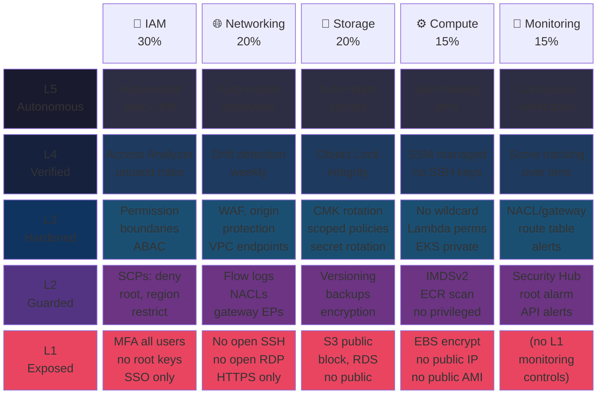

[](https://github.com/remedysec/csmm)

# Cloud Security Maturity Model (CSMM)

DORA metrics for cloud security. One score, five pillars, five levels.

```
L1 ████████████████████░ 82%
L2 █████████████░░░░░░░ 64%
L3 ████████░░░░░░░░░░░░ 41%
L4 ░░░░░░░░░░░░░░░░░░░░ (locked — reach 80% on L3 first)
L5 ░░░░░░░░░░░░░░░░░░░░ (locked — reach 80% on L4 first)
Overall: Level 2 Guarded — 58/100
```

---

## What is CSMM?

CSMM is an open, scored, leveled maturity model for AWS cloud security. It defines **WHAT** to secure (controls), **WHEN** to secure it (maturity levels), and **HOW** to measure progress (scoring). Think "DORA metrics, but for cloud security."

---

## The Framework

```
                        ╔══════════════════════════╗
                        ║     L5  AUTONOMOUS       ║
                        ║   Self-healing, zero-     ║
                        ║   trust, auto-remediate   ║
                     ╔══╩══════════════════════════╩══╗
                     ║       L4  VERIFIED              ║
                     ║   Drift detection, CI/CD gates, ║
                     ║   blast radius, IaC governance   ║
                  ╔══╩══════════════════════════════════╩══╗
                  ║         L3  HARDENED                    ║
                  ║   Least privilege, ABAC, data           ║
                  ║   perimeters, cross-account trust       ║
               ╔══╩════════════════════════════════════════╩══╗
               ║           L2  GUARDED                        ║
               ║   SCPs, flow logs, CloudTrail, encryption,   ║
               ║   monitoring alarms, baseline guardrails     ║
            ╔══╩══════════════════════════════════════════════╩══╗
            ║             L1  EXPOSED                            ║
            ║   MFA, root lockdown, public access blocks,       ║
            ║   default SG restrictions, basic encryption       ║
            ╚════════════════════════════════════════════════════╝
            ┃ IAM 30%  ┃ NET 20%  ┃ STR 20%  ┃ CMP 15% ┃ MON 15% ┃
```

Each level builds on the one below it. **Levels are gated** — you must score ≥80% on a level before the next unlocks. You can't skip MFA by being great at ABAC.

### Levels × Pillars



### Scoring at a Glance


| Severity | Weight | | Level | Weight | | Pillar | Weight |
|----------|--------|-|-------|--------|-|--------|--------|
| Critical | 4× | | L1 | 0.35 | | IAM | 30% |
| High | 3× | | L2 | 0.25 | | Networking | 20% |
| Medium | 2× | | L3 | 0.20 | | Storage | 20% |
| Low | 1× | | L4 | 0.12 | | Compute | 15% |
| | | | L5 | 0.08 | | Monitoring | 15% |

---

## Quick Start

Self-assess in 10 minutes with our checklist: [self-assessment/checklist.md](self-assessment/checklist.md)

---

## Specification & Controls

- [spec/](spec/) — Full model specification
- [controls/](controls/) — Control definitions by pillar and level
- [docs/iam-pillar.md](docs/iam-pillar.md) — IAM pillar deep dive (26 controls, visual maturity map)
- [self-assessment/](self-assessment/) — Checklist and scoring guide

---

## How CSMM Compares

| | CIS Benchmarks | AWS SMM v2 | NIST CSF | Prowler | **CSMM** |
|---|---|---|---|---|---|
| Type | Checklist | Phases | Framework | Scanner | Maturity model |
| Levels | None | 4 phases | 4 tiers | None | 5 levels (gated) |
| Scoring | Pass/fail | None | None | 0–100 (compliance) | 0–100 (maturity) |
| Open source | No (free PDF) | No (AWS-owned) | Yes | Partial | Yes (Apache 2.0) |
| Progression path | No | Yes | No | No | Yes (leveled) |
| Community-owned | No | No | No | Partial | Yes |

---

## Tooling

[RemedySec](https://remedysec.com) is the reference implementation — it ingests your AWS environment and returns a live CSMM score with per-control remediation guidance.

CSMM is tooling-agnostic. The spec is open and the scoring model is documented so any scanner can emit a compliant score.

---

## Contributing

Contributions are welcome. See [CONTRIBUTING.md](CONTRIBUTING.md) for guidelines on proposing new controls, adjusting weights, or improving the spec.

---

## License

Apache 2.0. See [LICENSE](LICENSE).
