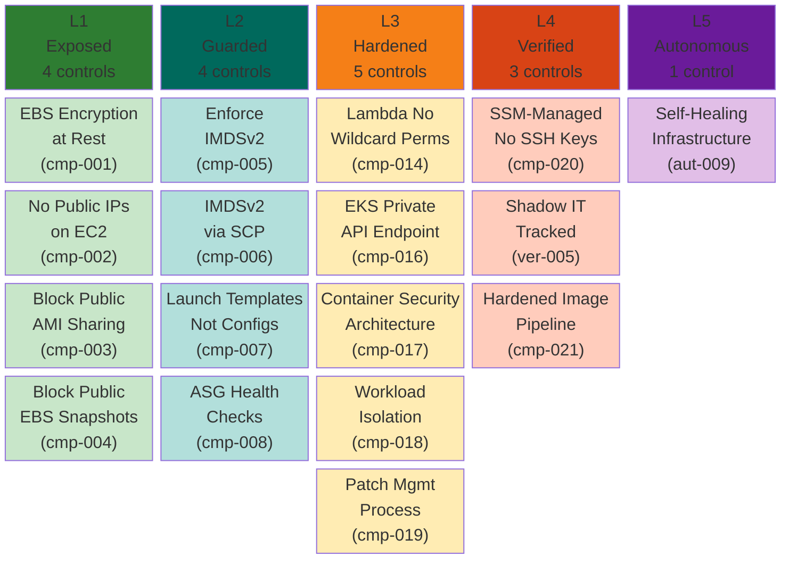

# Compute Pillar — Maturity Model

**Weight:** 15% of overall CSMM score | **Controls:** 17 | **Levels:** 5

---

## Maturity Levels at a Glance

---

## Control Reference

### L1 — Exposed (Foundational Hygiene)

| ID | Control | Priority | Severity |
|----|---------|----------|----------|
| csmm-cmp-001 | EBS Encryption at Rest | High | 3 |
| csmm-cmp-002 | No Public IPs on EC2 Unless Explicitly Required | High | 3 |
| csmm-cmp-003 | Block Public AMI Sharing | High | 3 |
| csmm-cmp-004 | Block Public EBS Snapshot Sharing | High | 3 |

### L2 — Guarded (Centralized Guardrails)

| ID | Control | Priority | Severity |
|----|---------|----------|----------|
| csmm-cmp-005 | Enforce IMDSv2 on All Instances | High | 3 |
| csmm-cmp-006 | Enforce IMDSv2 via SCP | High | 3 |
| csmm-cmp-007 | Use Launch Templates Not Launch Configurations | Medium | 2 |
| csmm-cmp-008 | ASG Health Checks Enabled | Medium | 2 |

### L3 — Hardened (Security Architecture)

| ID | Control | Priority | Severity |
|----|---------|----------|----------|
| csmm-cmp-014 | Lambda No Wildcard IAM Permissions | High | 3 |
| csmm-cmp-016 | EKS Private API Endpoint | High | 3 |
| csmm-cmp-017 | Container Security Architecture | High | 3 |
| csmm-cmp-018 | Workload Isolation Strategy | High | 3 |
| csmm-cmp-019 | Patch Management Process | High | 3 |

### L4 — Verified (Continuous Scanning)

| ID | Control | Priority | Severity |
|----|---------|----------|----------|
| csmm-cmp-020 | SSM-Managed Instances (No SSH Keys) | High | 3 |
| csmm-ver-005 | Shadow IT Tracked | High | 3 |
| csmm-cmp-021 | Hardened Image Pipeline (Golden AMIs) | High | 3 |

### L5 — Autonomous (Self-Healing)

| ID | Control | Priority | Severity |
|----|---------|----------|----------|
| csmm-aut-009 | Self-Healing Infrastructure | High | 3 |

---

## Progression Path

