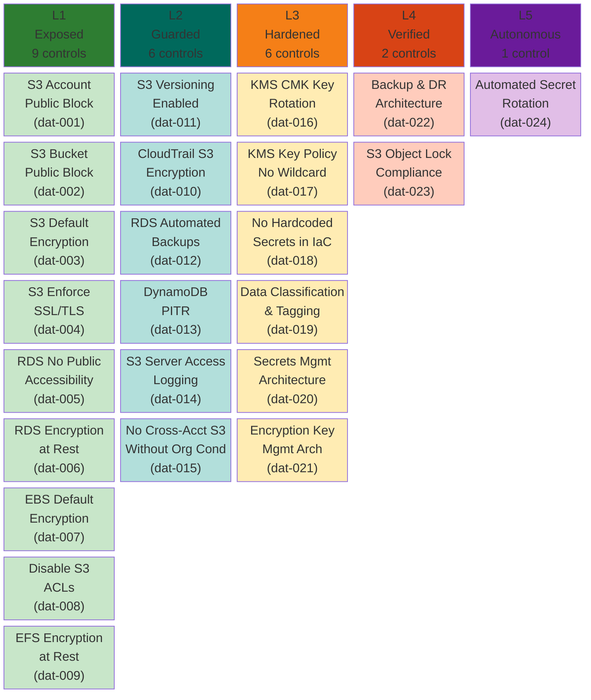
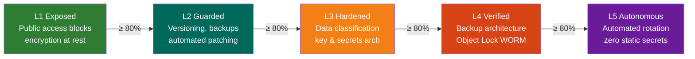

# Data Pillar — Maturity Model

**Weight:** 20% of overall CSMM score | **Controls:** 24 | **Levels:** 5

---

## Maturity Levels at a Glance

---

## Control Reference

### L1 — Exposed (Foundational Hygiene)

| ID | Control | Priority | Severity |
|----|---------|----------|----------|
| csmm-dat-001 | S3 Account-Level Public Access Block | Critical | 4 |
| csmm-dat-002 | S3 Bucket-Level Public Access Block | Critical | 4 |
| csmm-dat-003 | S3 Default Encryption Enabled | High | 3 |
| csmm-dat-004 | S3 Enforce SSL/TLS via Bucket Policy | High | 3 |
| csmm-dat-005 | RDS No Public Accessibility | Critical | 4 |
| csmm-dat-006 | RDS Encryption at Rest | High | 3 |
| csmm-dat-007 | EBS Default Encryption Enabled | High | 3 |
| csmm-dat-008 | Disable S3 ACLs (BucketOwnerEnforced) | Medium | 2 |
| csmm-dat-009 | EFS File System Encryption at Rest | High | 3 |

### L2 — Guarded (Centralized Guardrails)

| ID | Control | Priority | Severity |
|----|---------|----------|----------|
| csmm-dat-010 | CloudTrail S3 Bucket Encryption | High | 3 |
| csmm-dat-011 | S3 Versioning Enabled | High | 3 |
| csmm-dat-012 | RDS Automated Backups Enabled | High | 3 |
| csmm-dat-013 | DynamoDB Point-in-Time Recovery | High | 3 |
| csmm-dat-014 | S3 Server Access Logging Enabled on Sensitive Buckets | High | 3 |
| csmm-dat-015 | No Cross-Account S3 Bucket Access Without Organization Condition | Critical | 4 |

### L3 — Hardened (Security Architecture)

| ID | Control | Priority | Severity |
|----|---------|----------|----------|
| csmm-dat-016 | KMS CMK Key Rotation Enabled | High | 3 |
| csmm-dat-017 | KMS Key Policies — No Overly Permissive Access | Critical | 4 |
| csmm-dat-018 | No Hardcoded Secrets in IaC | Critical | 4 |
| csmm-dat-019 | Data Classification and Tagging Strategy | High | 3 |
| csmm-dat-020 | Secrets Management Architecture | High | 3 |
| csmm-dat-021 | Encryption Key Management Architecture | High | 3 |

### L4 — Verified (Continuous Scanning)

| ID | Control | Priority | Severity |
|----|---------|----------|----------|
| csmm-dat-022 | Backup and Disaster Recovery Architecture | High | 3 |
| csmm-dat-023 | S3 Object Lock for Compliance Data | Medium | 2 |

### L5 — Autonomous (Self-Healing)

| ID | Control | Priority | Severity |
|----|---------|----------|----------|
| csmm-dat-024 | Automated Secret Rotation and Credential Lifecycle | High | 3 |

---

## Progression Path

