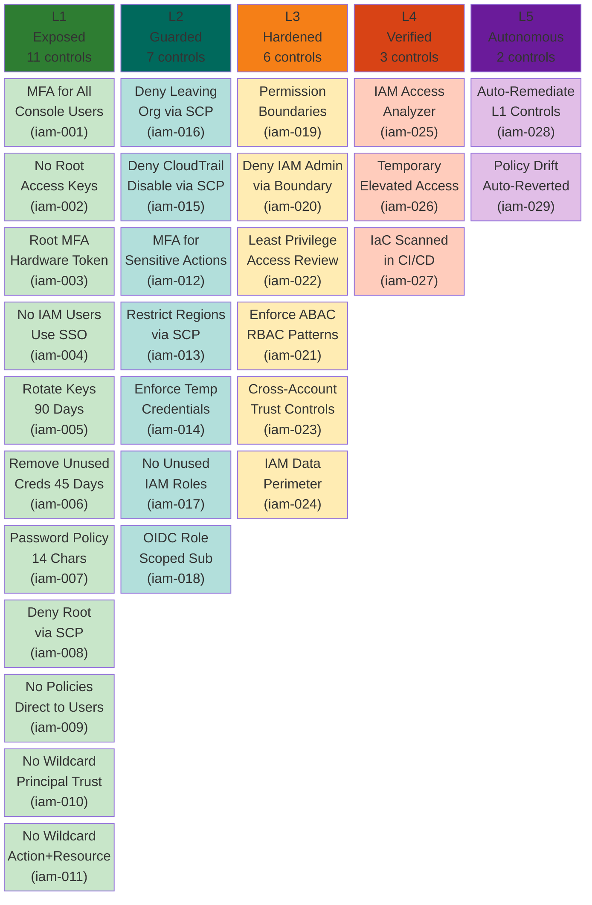
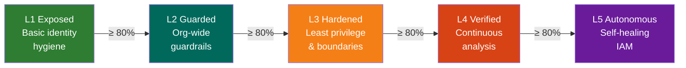

# IAM Pillar — Maturity Model

**Weight:** 30% of overall CSMM score | **Controls:** 29 | **Levels:** 5

---

## Maturity Levels at a Glance

---

## Control Reference

### L1 — Exposed (Foundational Hygiene)

| ID | Control | Priority | Severity |
|----|---------|----------|----------|
| csmm-iam-001 | Enforce MFA for All Console Users | Critical | 4 |
| csmm-iam-002 | No Root Account Access Keys | Critical | 4 |
| csmm-iam-003 | Enable Root Account MFA with Hardware Token | Critical | 4 |
| csmm-iam-004 | No IAM User Creation — Use SSO/Federation | High | 3 |
| csmm-iam-005 | Rotate Access Keys Within 90 Days | High | 3 |
| csmm-iam-006 | Remove Unused Credentials After 45 Days | High | 3 |
| csmm-iam-007 | Password Policy Minimum 14 Characters | Medium | 2 |
| csmm-iam-008 | Deny Root Usage via SCP | Critical | 4 |
| csmm-iam-009 | No IAM Policies Attached Directly to Users | Medium | 2 |
| csmm-iam-010 | No IAM Role Trust Policy with Wildcard Principal and No Condition | Critical | 4 |
| csmm-iam-011 | No IAM Policies with Wildcard Action and Wildcard Resource | Critical | 4 |

### L2 — Guarded (Centralized Guardrails)

| ID | Control | Priority | Severity |
|----|---------|----------|----------|
| csmm-iam-012 | Require MFA for Sensitive Actions via SCP | High | 3 |
| csmm-iam-013 | Restrict Regions via SCP | High | 3 |
| csmm-iam-014 | Enforce Temporary Credentials Over Long-Lived Keys | High | 3 |
| csmm-iam-015 | Deny CloudTrail Disable via SCP | Critical | 4 |
| csmm-iam-016 | Deny Leaving Organization via SCP | Critical | 4 |
| csmm-iam-017 | No Unused IAM Roles (Not Assumed in 90 Days) | Medium | 2 |
| csmm-iam-018 | OIDC Federated Role Trust Policies Scoped to Specific Subjects | Critical | 4 |

### L3 — Hardened (Privilege Boundaries)

| ID | Control | Priority | Severity |
|----|---------|----------|----------|
| csmm-iam-019 | Permission Boundaries on All Non-Admin Roles | High | 3 |
| csmm-iam-020 | Deny IAM Admin Actions via Boundary | Critical | 4 |
| csmm-iam-021 | Enforce ABAC/RBAC Access Patterns | Medium | 2 |
| csmm-iam-022 | Periodic Least Privilege Access Review | High | 3 |
| csmm-iam-023 | Cross-Account IAM Trust Controls | High | 3 |
| csmm-iam-024 | IAM Data Perimeter Controls | High | 3 |

### L4 — Verified (Continuous Scanning)

| ID | Control | Priority | Severity |
|----|---------|----------|----------|
| csmm-iam-025 | IAM Access Analyzer Enabled | High | 3 |
| csmm-iam-026 | Temporary Elevated Access (JIT/Break-Glass) | High | 3 |
| csmm-iam-027 | IaC Scanned in CI/CD Before Merge | Critical | 4 |

### L5 — Autonomous (Self-Healing)

| ID | Control | Priority | Severity |
|----|---------|----------|----------|
| csmm-iam-028 | Auto-Remediation for L1 Controls | High | 3 |
| csmm-iam-029 | Policy Drift Auto-Reverted | High | 3 |

---

## Progression Path

**Gating rule:** You must score ≥ 80% on a level before the next level's controls count toward your score.
