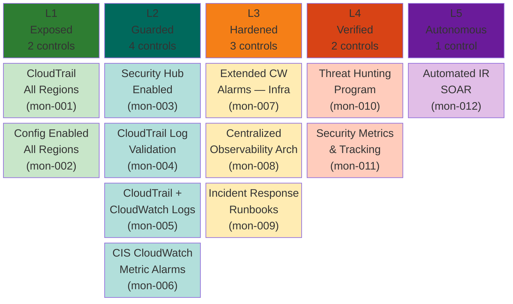
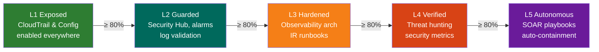

# Monitoring Pillar — Maturity Model

**Weight:** 15% of overall CSMM score | **Controls:** 12 | **Levels:** 5

---

## Maturity Levels at a Glance

---

## The Config-to-Architecture Shift

Monitoring is where the CSMM philosophy is most visible. L2 is CloudWatch alarm configuration — pure config checks that any scanner covers. **The real maturity starts at L3:**

| Level | What it checks | Example |
|-------|---------------|---------|
| L1 | Is logging turned on? | "CloudTrail enabled in all regions" |
| L2 | Are the right alarms configured? | "CIS CloudWatch alarms for all 11 required events" |
| L3 | Is your observability **architecture** sound? | "All logs flow to a centralized SIEM with cross-account correlation" |
| L4 | Do you have **processes** for proactive security? | "Monthly threat hunts with MITRE ATT&CK coverage tracking" |
| L5 | Does your environment **respond autonomously**? | "SOAR playbooks auto-isolate compromised instances in < 5 min" |

---

## Control Reference

### L1 — Exposed (Logging Foundations)

| ID | Control | Priority | Severity |
|----|---------|----------|----------|
| csmm-mon-001 | CloudTrail Enabled in All Regions | Critical | 4 |
| csmm-mon-002 | AWS Config Enabled in All Regions | Critical | 4 |

### L2 — Guarded (CloudWatch Alarms)

| ID | Control | Priority | Severity |
|----|---------|----------|----------|
| csmm-mon-003 | AWS Security Hub Enabled | Critical | 4 |
| csmm-mon-004 | CloudTrail Log File Validation | High | 3 |
| csmm-mon-005 | CloudTrail Integrated with CloudWatch Logs | High | 3 |
| csmm-mon-006 | CIS CloudWatch Metric Alarms Configured | High | 3 |

### L3 — Hardened (Observability Architecture)

| ID | Control | Priority | Severity |
|----|---------|----------|----------|
| csmm-mon-007 | Extended CloudWatch Alarms for Infrastructure Changes | Medium | 2 |
| csmm-mon-008 | Centralized Security Observability Architecture | High | 3 |
| csmm-mon-009 | Incident Response Process and Runbooks | High | 3 |

### L4 — Verified (Proactive Security)

| ID | Control | Priority | Severity |
|----|---------|----------|----------|
| csmm-mon-010 | Threat Hunting Program | Medium | 2 |
| csmm-mon-011 | Security Metrics and Maturity Tracking | Medium | 2 |

### L5 — Autonomous (Self-Healing)

| ID | Control | Priority | Severity |
|----|---------|----------|----------|
| csmm-mon-012 | Automated Incident Response (SOAR) | High | 3 |

---

## Progression Path

