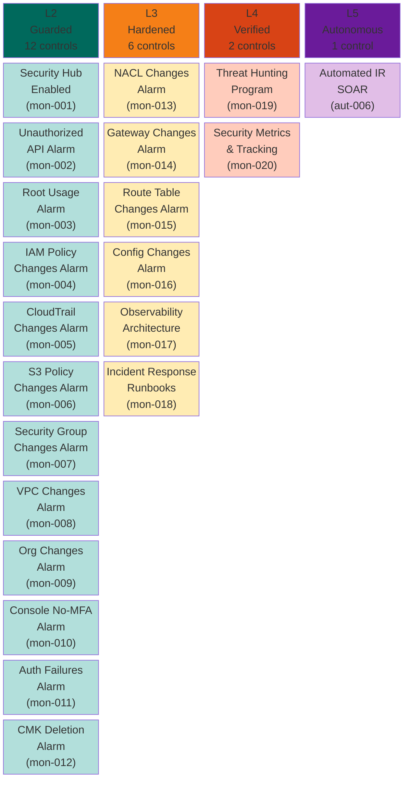
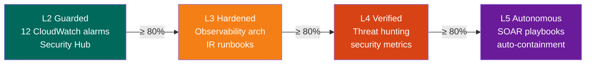

# Monitoring Pillar — Maturity Model

**Weight:** 15% of overall CSMM score | **Controls:** 21 | **Levels:** 4 (no L1)

---

## Maturity Levels at a Glance

---

## The Config-to-Architecture Shift

Monitoring is where the CSMM philosophy is most visible. L2 is 12 CloudWatch alarms — pure config checks that any scanner covers. **The real maturity starts at L3:**

| Level | What it checks | Example |
|-------|---------------|---------|
| L2 | Is the alarm configured? | "CloudWatch alarm for root usage exists" |
| L3 | Is your observability **architecture** sound? | "All logs flow to a centralized SIEM with cross-account correlation" |
| L4 | Do you have **processes** for proactive security? | "Monthly threat hunts with MITRE ATT&CK coverage tracking" |
| L5 | Does your environment **respond autonomously**? | "SOAR playbooks auto-isolate compromised instances in < 5 min" |

---

## Control Reference

### L2 — Guarded (CloudWatch Alarms)

| ID | Control | Priority | Severity |
|----|---------|----------|----------|
| csmm-mon-001 | AWS Security Hub Enabled | Critical | 4 |
| csmm-mon-002 | CloudWatch Alarm for Unauthorized API Calls | High | 3 |
| csmm-mon-003 | CloudWatch Alarm for Root Account Usage | Critical | 4 |
| csmm-mon-004 | CloudWatch Alarm for IAM Policy Changes | High | 3 |
| csmm-mon-005 | CloudWatch Alarm for CloudTrail Config Changes | High | 3 |
| csmm-mon-006 | CloudWatch Alarm for S3 Bucket Policy Changes | High | 3 |
| csmm-mon-007 | CloudWatch Alarm for Security Group Changes | High | 3 |
| csmm-mon-008 | CloudWatch Alarm for VPC Changes | Medium | 2 |
| csmm-mon-009 | CloudWatch Alarm for Organizations Changes | High | 3 |
| csmm-mon-010 | CloudWatch Alarm for Console Sign-In Without MFA | High | 3 |
| csmm-mon-011 | CloudWatch Alarm for Console Authentication Failures | Medium | 2 |
| csmm-mon-012 | CloudWatch Alarm for CMK Disable/Deletion | High | 3 |

### L3 — Hardened (Observability Architecture)

| ID | Control | Priority | Severity |
|----|---------|----------|----------|
| csmm-mon-013 | CloudWatch Alarm for NACL Changes | Medium | 2 |
| csmm-mon-014 | CloudWatch Alarm for Network Gateway Changes | Medium | 2 |
| csmm-mon-015 | CloudWatch Alarm for Route Table Changes | Medium | 2 |
| csmm-mon-016 | CloudWatch Alarm for Config Configuration Changes | Medium | 2 |
| csmm-mon-017 | Centralized Security Observability Architecture | High | 3 |
| csmm-mon-018 | Incident Response Process and Runbooks | High | 3 |

### L4 — Verified (Proactive Security)

| ID | Control | Priority | Severity |
|----|---------|----------|----------|
| csmm-mon-019 | Threat Hunting Program | Medium | 2 |
| csmm-mon-020 | Security Metrics and Maturity Tracking | Medium | 2 |

### L5 — Autonomous (Self-Healing)

| ID | Control | Priority | Severity |
|----|---------|----------|----------|
| csmm-aut-006 | Automated Incident Response (SOAR) | High | 3 |

---

## Progression Path

