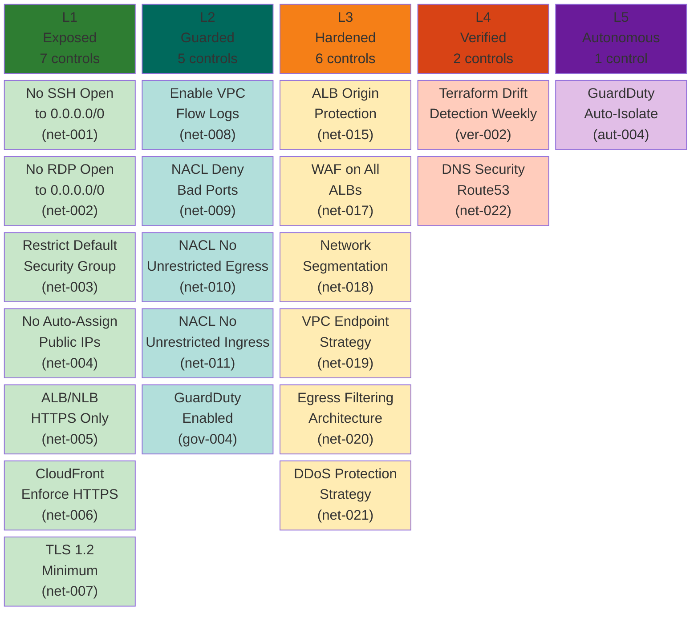
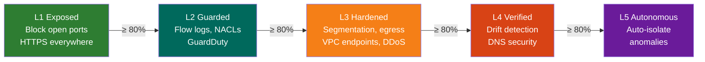

# Networking Pillar — Maturity Model

**Weight:** 20% of overall CSMM score | **Controls:** 16 | **Levels:** 5

---

## Maturity Levels at a Glance

---

## Control Reference

### L1 — Exposed (Foundational Hygiene)

| ID | Control | Priority | Severity |
|----|---------|----------|----------|
| csmm-net-001 | No SSH (22) Open to 0.0.0.0/0 | Critical | 4 |
| csmm-net-002 | No RDP (3389) Open to 0.0.0.0/0 | Critical | 4 |
| csmm-net-003 | Restrict Default Security Group to No Traffic | High | 3 |
| csmm-net-004 | No Auto-Assign Public IPs in Subnets | High | 3 |
| csmm-net-005 | ALB/NLB HTTPS Only | High | 3 |
| csmm-net-006 | CloudFront Enforce HTTPS | High | 3 |
| csmm-net-007 | TLS 1.2 Minimum Everywhere | High | 3 |

### L2 — Guarded (Centralized Guardrails)

| ID | Control | Priority | Severity |
|----|---------|----------|----------|
| csmm-net-008 | Enable VPC Flow Logs | High | 3 |
| csmm-net-009 | NACL Deny Known Bad Ports | Medium | 2 |
| csmm-net-010 | NACL No Unrestricted Egress | Medium | 2 |
| csmm-net-011 | NACL No Unrestricted Ingress | Medium | 2 |
| csmm-gov-004 | GuardDuty Enabled | Critical | 4 |

### L3 — Hardened (Security Architecture)

| ID | Control | Priority | Severity |
|----|---------|----------|----------|
| csmm-net-015 | ALB Origin Protection | High | 3 |
| csmm-net-017 | WAF Associated with ALBs | High | 3 |
| csmm-net-018 | Network Segmentation Strategy | High | 3 |
| csmm-net-019 | VPC Endpoint Strategy for Private Connectivity | High | 3 |
| csmm-net-020 | Egress Filtering Architecture | High | 3 |
| csmm-net-021 | DDoS Protection Strategy | Medium | 2 |

### L4 — Verified (Continuous Scanning)

| ID | Control | Priority | Severity |
|----|---------|----------|----------|
| csmm-ver-002 | Terraform Drift Detection Runs Weekly | High | 3 |
| csmm-net-022 | DNS Security and Route53 Hardening | High | 3 |

### L5 — Autonomous (Self-Healing)

| ID | Control | Priority | Severity |
|----|---------|----------|----------|
| csmm-aut-004 | Anomaly-Driven GuardDuty Auto-Isolate | High | 3 |

---

## Progression Path

