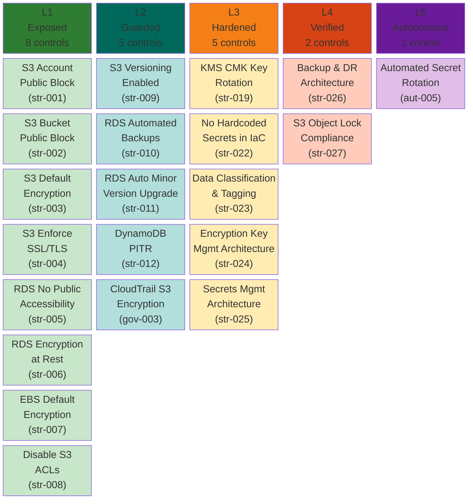
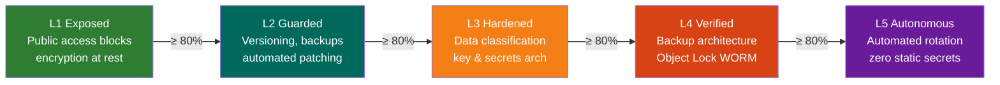

# Storage Pillar — Maturity Model

**Weight:** 20% of overall CSMM score | **Controls:** 21 | **Levels:** 5

---

## Maturity Levels at a Glance

---

## Control Reference

### L1 — Exposed (Foundational Hygiene)

| ID | Control | Priority | Severity |
|----|---------|----------|----------|
| csmm-str-001 | S3 Account-Level Public Access Block | Critical | 4 |
| csmm-str-002 | S3 Bucket-Level Public Access Block | Critical | 4 |
| csmm-str-003 | S3 Default Encryption Enabled | High | 3 |
| csmm-str-004 | S3 Enforce SSL/TLS via Bucket Policy | High | 3 |
| csmm-str-005 | RDS No Public Accessibility | Critical | 4 |
| csmm-str-006 | RDS Encryption at Rest | High | 3 |
| csmm-str-007 | EBS Default Encryption Enabled | High | 3 |
| csmm-str-008 | Disable S3 ACLs (BucketOwnerEnforced) | High | 3 |

### L2 — Guarded (Centralized Guardrails)

| ID | Control | Priority | Severity |
|----|---------|----------|----------|
| csmm-str-009 | S3 Versioning Enabled | High | 3 |
| csmm-str-010 | RDS Automated Backups Enabled | High | 3 |
| csmm-str-011 | RDS Auto Minor Version Upgrade | Medium | 2 |
| csmm-str-012 | DynamoDB Point-in-Time Recovery | High | 3 |
| csmm-gov-003 | CloudTrail S3 Bucket Encryption | High | 3 |

### L3 — Hardened (Security Architecture)

| ID | Control | Priority | Severity |
|----|---------|----------|----------|
| csmm-str-019 | KMS CMK Key Rotation Enabled | High | 3 |
| csmm-str-022 | No Hardcoded Secrets in IaC | High | 3 |
| csmm-str-023 | Data Classification and Tagging Strategy | High | 3 |
| csmm-str-024 | Encryption Key Management Architecture | High | 3 |
| csmm-str-025 | Secrets Management Architecture | High | 3 |

### L4 — Verified (Continuous Scanning)

| ID | Control | Priority | Severity |
|----|---------|----------|----------|
| csmm-str-026 | Backup and Disaster Recovery Architecture | High | 3 |
| csmm-str-027 | S3 Object Lock for Compliance Data | Medium | 2 |

### L5 — Autonomous (Self-Healing)

| ID | Control | Priority | Severity |
|----|---------|----------|----------|
| csmm-aut-005 | Automated Secret Rotation and Credential Lifecycle | High | 3 |

---

## Progression Path

